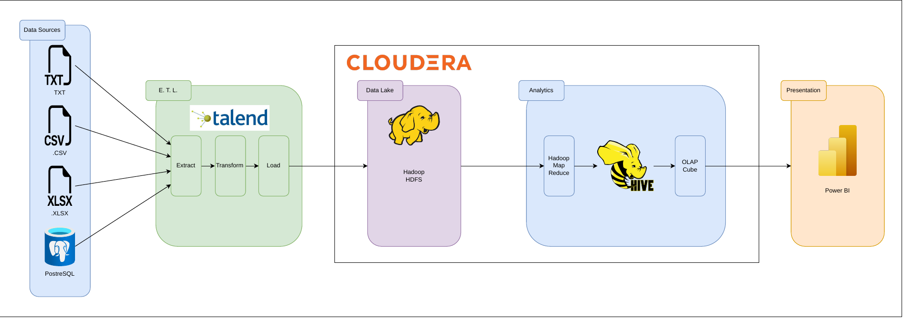

# Healthcare Big Data Pipeline and Data Warehouse Architecture

## Repository Notice

Due to infrastructure constraints and data governance policies, the executable source code (Talend jobs, HiveQL scripts, and MapReduce configurations) and raw datasets are not hosted in this repository. The pipeline was developed and executed directly within a restricted, cluster-based Cloudera Big Data environment handling sensitive healthcare records. 

This documentation provides a comprehensive overview of the system architecture, data ingestion workflow, and dimensional data warehouse design implemented for this project.

---

## Project Overview

The objective of this project is to consolidate heterogeneous healthcare datasets—ranging from clinical hospitalizations and medical diagnostics to practitioner directories, civil mortality records, and patient satisfaction surveys—into a centralized analytical repository. 

By leveraging an end-to-end Big Data architecture, the system processes raw structured and semi-structured data into a multidimensional star schema, enabling high-performance OLAP querying and interactive Business Intelligence reporting.

---

## End-to-End Pipeline Architecture

The data pipeline is organized into five distinct architectural layers, transitioning raw multi-source inputs into actionable visual analytics:

### 1. Data Sources
The ingestion layer consolidates data from multiple disparate formats and operational systems:
* **Flat Files:** `.TXT`, `.CSV`, and `.XLSX` files containing batch exports of administrative, diagnostic, and survey data.
* **Relational Database:** A `PostgreSQL` operational database storing structured clinical and institutional records.

### 2. Extract, Transform, Load (ETL)
* **Tooling:** **Talend**
* **Function:** Connects to all heterogeneous data sources to extract raw records, perform data cleansing, standardization, schema mapping, and deduplication, and load the processed datasets into the Big Data storage layer.

### 3. Data Lake Storage (Cloudera Ecosystem)
* **Tooling:** **Hadoop HDFS** (hosted on **Cloudera**)
* **Function:** Serves as the distributed, fault-tolerant storage layer for ingested datasets, accommodating high volumes of historical healthcare data across cluster nodes.

### 4. Distributed Processing and Data Warehousing
* **Tooling:** **Hadoop MapReduce**, **Apache Hive**, and **OLAP Cube**
* **Function:** 
  * **Hadoop MapReduce** handles heavy distributed batch transformations and aggregations across the HDFS cluster.
  * **Apache Hive** provides a SQL-like abstraction layer over HDFS to structure the refined data into the star schema Data Warehouse.
  * **OLAP Cube** pre-aggregates multidimensional metrics across key axes (time, geography, medical specialty, institution) to ensure low-latency analytical querying.

### 5. Presentation Layer
* **Tooling:** **Microsoft Power BI**
* **Function:** Connects directly to the analytical layer to deliver interactive dashboards, tracking hospital performance, patient satisfaction grades, mortality demographics, and diagnostic trends.

---

## Data Warehouse Architecture (Star Schema)

The analytical database is modeled as a **Star Schema** optimized for Online Analytical Processing (OLAP). It centers around a core fact table surrounded by six descriptive dimension tables.

### Fact Table

#### `Fact_results`
Acts as the central transactional bridge linking clinical events, healthcare providers, institutions, outcomes, and patient feedback.
* **Foreign Keys:**
  * `id_hospitalisation` (links to `Dimension_Hospitalisation`)
  * `id_professional` (links to `Dimension_Professional`)
  * `id_deaths` (links to `Dimension_death`)
  * `id_satisfaction` (links to `Dimension_satisfaction`)
  * `id_diagnostic` (links to `Dimension_diagnostic`)
  * `id_healthcare_institution` (links to `Dimension_healthcare_institutions`)

---

### Dimension Tables

#### 1. `Dimension_Hospitalisation`
Captures temporal and clinical details regarding patient stays.
* **Attributes:** `id_hospitalisation` (PK), `entry_date`, `duration`, `diagnosis_code`, `diagnosis_content`

#### 2. `Dimension_diagnostic`
Provides standardized medical classification descriptions for clinical analysis.
* **Attributes:** `id_diagnostic` (PK), `diagnosis_code`, `diagnosis_content`

#### 3. `Dimension_healthcare_institutions`
Contains comprehensive administrative, geographic, and legal identification data for medical facilities (including French administrative identifiers).
* **Attributes:** `id_healthcare_institutions` (PK), `Corporate_name`, `Siren`, `Siret`, `Address`, `Road_number`, `Road_type`, `Road`, `Complement`, `Repetition_complement`, `Distribution_mention`, `Cedex`, `Zip_code`, `City`, `Country`, `Email`, `Phone`, `Phone_2`, `Fax`

#### 4. `Dimension_death`
Stores civil registry and demographic attributes related to mortality records.
* **Attributes:** `id_deaths` (PK), `death_act_number`, `First_name`, `Last_name`, `Gender`, `Birthdate`, `Birth_location_code`, `Birth_location`, `Birth_country`, `Death_date`, `Death_location_code`

#### 5. `Dimension_Professional`
Details the demographics, categorization, and medical specialization of healthcare practitioners.
* **Attributes:** `id_professional` (PK), `First_name`, `Last_name`, `Gender`, `Professional_categorie`, `Profession`, `Specialty`, `City`

#### 6. `Dimension_satisfaction`
Records patient feedback metrics used to evaluate care quality.
* **Attributes:** `id_satisfaction` (PK), `grade`

---

## Technology Stack Summary

| Layer | Technologies |
| :--- | :--- |
| **Data Sources** | PostgreSQL, CSV, XLSX, TXT |
| **Data Integration (ETL)** | Talend |
| **Big Data Platform** | Cloudera |
| **Distributed Storage** | Hadoop HDFS |
| **Processing & Warehousing** | Hadoop MapReduce, Apache Hive, OLAP Cube |
| **Business Intelligence** | Microsoft Power BI |

---

## Key Analytical Use Cases

With this architecture in place, the Power BI reporting layer supports the following analyses:
* **Hospitalization Efficiency:** Analyzing average stay `duration` across specific `diagnosis_code` categories and institutions.
* **Quality of Care Assessment:** Correlating patient satisfaction `grade` metrics with medical `Specialty`, `Professional_categorie`, and facility locations.
* **Demographic and Mortality Analysis:** Evaluating mortality trends by geographic region (`Death_location_code`, `Birth_country`), age cohorts (`Birthdate` vs. `Death_date`), and clinical diagnoses.
* **Institutional Benchmarking:** Comparing operational volume and patient outcomes across healthcare facilities using standardized `Siren`/`Siret` and geographic hierarchies.